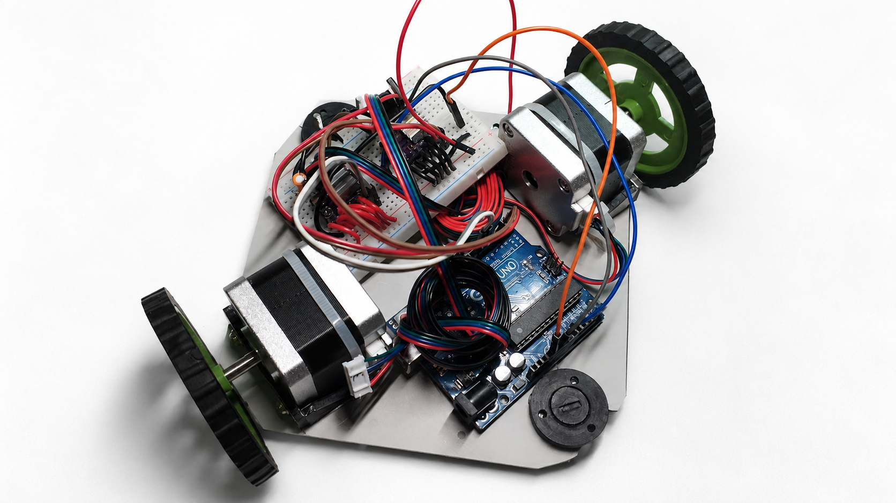
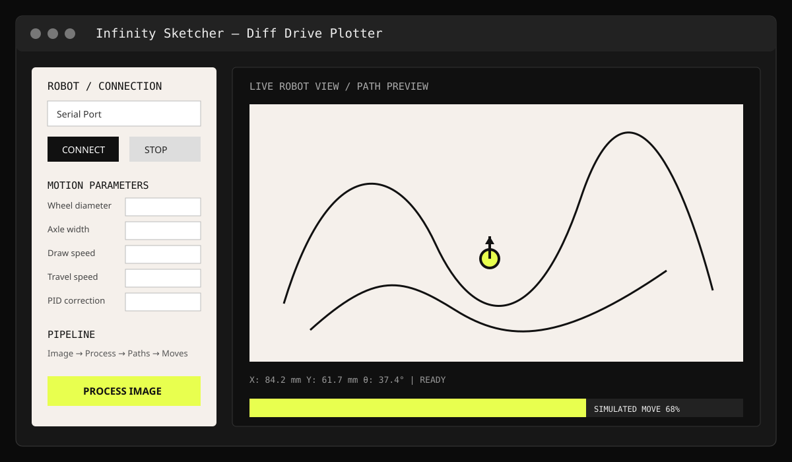

<div align="center">

# Infinity-Sketcher

**A differential-drive robot that turns images into physical drawings.**



Python • OpenCV • Arduino • NEMA 17 • Differential-drive kinematics • PID

</div>

---

## Contents

- [What is Infinity-Sketcher?](#what-is-infinity-sketcher)
- [System Architecture](#system-architecture)
- [Software Pipeline](#software-pipeline)
- [Motion and Control](#motion-and-control)
- [Skeletonization](#skeletonization)
- [Hardware](#hardware)
- [GUI](#gui)
- [Interactive Plotter Lab](#interactive-plotter-lab)
- [Quick Start](#quick-start)
- [Repository Structure](#repository-structure)
- [Technical Notes](#technical-notes)
- [Future Work](#future-work)

---

## What is Infinity-Sketcher?

Infinity-Sketcher is a mobile CNC drawing robot built around a **Smart Host, Dumb Executor** architecture. The computer handles image processing, path optimization, kinematics and simulation; the Arduino focuses on deterministic motor execution and hardware safety.

Instead of moving a pen across a fixed XY gantry, the differential-drive robot moves itself across the drawing surface. This gives the system a potentially much larger working area than a conventional fixed-frame plotter.

### Core goals

| Goal | Approach |
|---|---|
| Image → drawing | Computer-vision pipeline generates drawable strokes |
| Accurate motion | Differential-drive kinematics + dead-reckoning simulation |
| Smooth curves | Fine segmentation + acceleration profiling |
| Straight-line correction | Real-time PID timing correction |
| Efficient plotting | Bidirectional nearest-neighbor stroke ordering |
| Reliable execution | Synchronous host ↔ Arduino protocol |
| Safe hardware | Driver fault detection + motor disable + STOP |

---

## System Architecture

```text
                    COMPUTER / HOST
┌──────────────────────────────────────────────────────────┐
│ Image → Process → Trace → Optimize → Kinematics         │
│                              │                           │
│                         Simulation / Preview             │
│                              │                           │
│                           USB Serial                     │
└──────────────────────────────┼───────────────────────────┘
                               ▼
                       ┌───────────────┐
                       │    Arduino    │
                       │               │
                       │ Command parse │
                       │ Sync pulses   │
                       │ Acceleration  │
                       │ PID correction│
                       │ Fault / STOP  │
                       └───────┬───────┘
                               ▼
                         Left / Right
                           steppers
```

The host/firmware separation keeps heavy computer vision, pathfinding and floating-point kinematics away from the ATmega328P while leaving the Arduino responsible for precise physical execution.

---

## Software Pipeline

```text
Raw Image
   │
   ▼
Pre-processing / Thresholding
   │
   ├── Vector / Contour tracing
   │
   └── Skeleton / Midline tracing
              │
              ▼
        Stroke polylines
              │
              ▼
     Nearest-neighbor ordering
              │
              ▼
       Resample + motion plan
              │
              ▼
       STEPS L:<n> R:<n>
              │
              ▼
           Arduino
```

The documented image pipeline uses resolution reduction, auto-inversion and binary thresholding before contour extraction. Douglas-Peucker simplification removes redundant vertices, reducing the number of physical moves while preserving shape.

The path planner treats stroke ordering as a Traveling Salesperson Problem variant: it checks both endpoints of every remaining stroke and reverses a stroke when approaching its far endpoint is shorter.

---

## Motion and Control

### Differential-drive kinematics

```text
S_mm  = (Full Steps × Microsteps) / (π × Wheel Diameter)
S_deg = (π × Axle Width / 360) × S_mm
```

For wheel commands `st_L` and `st_R`:

```text
d_L = st_L / S_mm
d_R = st_R / S_mm
d   = (d_L + d_R) / 2
Δθ  = (d_R - d_L) / Axle Width
```

The documented coordinate convention uses +Y as Up/North and +X as Right/East, with heading increasing clockwise.

### Toolpath generation

Strokes are divided into small segments. The robot rotates toward each segment bearing and then drives forward. Small segments approximate curves while retaining sharp corners.

### Arduino execution

**Bresenham-style synchronization** interleaves unequal left/right step counts so both motors finish a command together.

**Trapezoidal acceleration** ramps pulse timing into and out of a move to reduce stalling and mechanical shock.

**PID correction** is applied to straight commands to compensate for wheel asymmetry and reduce trajectory drift.

---

## Skeletonization

Thick raster strokes can produce an inner and outer contour. Infinity-Sketcher also explores morphological skeletonization to obtain a single central path.

The documented method repeatedly erodes and dilates the binary mask using a small structuring element, accumulating the surviving layers until a one-pixel-wide skeleton remains. This is intended to give the robot one physical pass per thick stroke instead of tracing both sides.

---

## Hardware

- Arduino Uno / Nano
- Two NEMA 17 stepper motors
- A4988 / DRV8825-class drivers
- Pen-lift servo
- Differential-drive chassis
- Shared motor enable and driver-fault monitoring

### Pinout

| Pin | Signal | Function |
|---:|---|---|
| 2 | STEP_L | Left step pulse |
| 3 | DIR_L | Left direction |
| 6 | STEP_R | Right step pulse |
| 7 | DIR_R | Right direction |
| 8 | EN_ALL | Shared motor enable |
| 9 | FLT_L | Left driver fault |
| 10 | FLT_R | Right driver fault |
| 11 | SERVO | Pen servo |

---

## GUI



The desktop GUI combines image import, processing, path generation, serial control, robot-state display and motion preview. The live preview is based on simulated motor steps and forward kinematics rather than simply displaying the source image.

The architecture review also documents a threaded Tkinter model: heavy image processing and blocking serial work run in background threads while UI updates return to the main event loop.

---

## Interactive Plotter Lab

[`plotter_lab_v19.html`](plotter_lab_v19.html) is a standalone browser laboratory for experimenting with the plotting pipeline and visualising processing/path-planning behaviour without connecting the physical robot.

---

## Quick Start

```bash
git clone https://github.com/Rutu2701/Infinity-Sketcher.git
cd Infinity-Sketcher
pip install -r requirements.txt
python v17.py
```

Then connect the Arduino, load an image, process it, inspect the generated path, run a pen-up/demo pass, and plot.

The firmware is uploaded separately through Arduino IDE using `firmware.ino`.

---

## Repository Structure

```text
Infinity-Sketcher/
├── v17.py                       # Main Python GUI
├── firmware.ino                 # Arduino executor
├── plotter_lab_v19.html         # Interactive browser lab
├── requirements.txt             # Python dependencies
├── docs/images/vehicle.png      # Vehicle photograph
├── docs/images/gui.svg          # GUI overview graphic
└── README.md                    # Project documentation
```

The main branch intentionally excludes generated caches, debug dumps, duplicate firmware versions and temporary image-processing outputs.

---

## Technical Notes

The engineering review covers the complete stack: host/firmware architecture, wiring, kinematics, contour extraction, path simplification, nearest-neighbor optimization, resample-and-drive motion, Bresenham synchronization, trapezoidal acceleration, PID correction, Tkinter concurrency, serial handshaking, dynamic timeouts, coordinate mirroring, dead-reckoning simulation, skeletonization, microstepping, fault handling and the future roadmap.

---

## Future Work

- Encoder feedback and closed-loop motion
- Improved skeleton graph tracing
- IMU-assisted slip correction
- Wireless host-to-robot communication
- Optical-flow position tracking
- Adaptive path segmentation
- G-code export

---

## License

MIT

<div align="center">

Built by **Rutu2701**.

</div>
